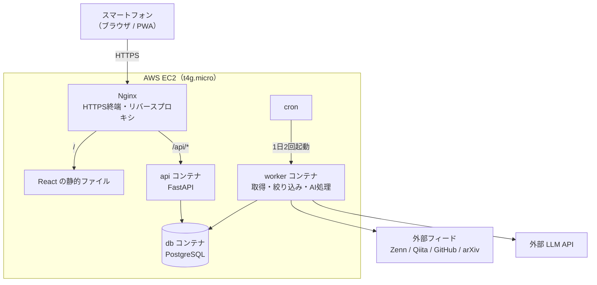

# Personal Intelligence Hub

技術記事・OSSのリリース・論文をフィード（RSS / Atom）から自動収集し、LLMで日本語に要約・分類して、スマホから短時間で確認できる個人用の情報収集アプリです。

- **実用**：毎日の情報収集を効率化する
- **学習**：AWS EC2 上での構築・デプロイ・運用を一通り経験する
- **転職**：設計判断・コスト管理・運用の工夫を説明できる成果物にする

現在は準備フェーズ（M0）です。アプリのコードはまだありません。進捗は [docs/development-plan.md](docs/development-plan.md) を参照してください。

## システム構成（予定）

## 技術スタック（予定）

| 領域 | 技術 |
|---|---|
| フロントエンド | React + TypeScript + Vite、Tailwind CSS |
| バックエンド | Python + FastAPI、SQLAlchemy 2.x、Alembic |
| 情報収集 | httpx + feedparser |
| DB | PostgreSQL |
| 実行環境 | Docker Compose |
| インフラ | AWS EC2（t4g.micro）、Nginx、Let's Encrypt、cron |

## ドキュメント

| 文書 | 内容 |
|---|---|
| [docs/spec.md](docs/spec.md) | 全体仕様（機能要件・技術選定・データモデル・費用見積もり） |
| [docs/development-plan.md](docs/development-plan.md) | 開発計画（マイルストーン・リスク対策） |
| [AGENTS.md](AGENTS.md) | AIコーディングエージェント向けの前提情報 |

## ライセンス

[MIT](LICENSE)
