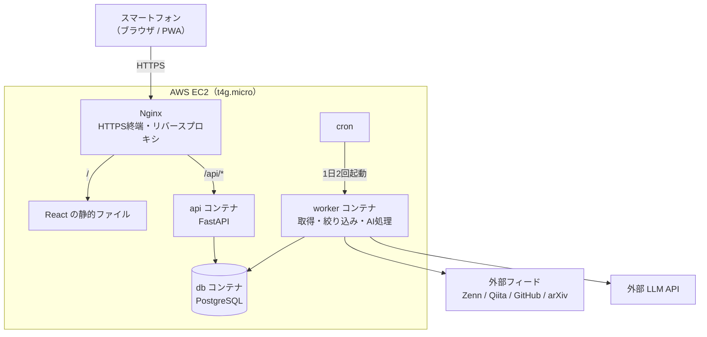

# Personal Intelligence Hub 仕様書（v0.3 叩き台）

## 0. 用語

| 用語 | 意味 |
|---|---|
| フィード（RSS / Atom） | Webサイトが最新記事の一覧（タイトル・URL・概要・公開日時）をXML形式で配信する仕組み。認証不要で取得できるが、取得できるのは最新の数十件のみで、検索や過去記事の取得はできない |
| 情報源 / 購読 | 情報源は追いかける対象（Zennのトピック、Qiitaのタグ、GitHubリポジトリのリリース、arXivのカテゴリなど）で、1つの情報源が1つのフィードURLに対応する。情報源を登録することを購読と呼ぶ |
| MVP | Minimum Viable Product。実際に使って価値を確かめられる最小限の製品。本アプリでは「毎日記事が自動で集まり、AI要約付きでスマホから読める状態」を指す |
| worker | 情報収集・AI処理を行うバッチ処理。Webアプリとは別プロセスで実行する |

## 1. 概要

### 1.1 コンセプト

自分が興味のある分野の情報（技術記事・OSSのリリース・論文）を自動収集し、AIが日本語で要約・分類したうえで、スマホから短時間で確認できる個人用の情報収集アプリ。

### 1.2 目的

| 目的 | 内容 |
|---|---|
| 実用 | 毎日の情報収集を効率化し、自分で使い続けられるアプリにする |
| 学習 | AWS（EC2）上での構築・デプロイ・運用を一通り経験する |
| 転職 | 設計判断・コスト管理・運用の工夫を説明できる成果物にする |

### 1.3 前提・制約

- 利用者は自分1人（マルチユーザー対応はしない）
- スマホ（ブラウザ）での利用を前提とし、PCでも閲覧できればよい
- 月額費用は AWS + AI API の合計で 3,000円以内
- 開発ペースは週数時間
- インフラは EC2 1台から始め、マネージドサービスは段階的に導入する

### 1.4 設計方針

- **決められた手順で動くパイプラインにする。** 取得・重複排除・保存は通常のコードで確実に行い、AIには要約・分類のみを任せる。自律的なエージェントは初期スコープ外。
- **取得処理とAI処理を分離する。** どちらかが失敗しても、未処理分だけを再実行できるようにする。
- **AIの利用量は常に上限を設けて記録する。** 1日あたりの処理件数の上限を設け、呼び出しごとのトークン数・推定費用をDBに保存する。
- **小さく作って早くデプロイする。** 最小の機能を一通り動かした段階でEC2にデプロイし、以降は使いながら改善する。

## 2. 情報源

### 2.1 対象と取得手段

MVPでは、すべてフィードとして扱う汎用の取得処理を1つ実装する。公式APIは、P2の「保存済み検索」（C08）で利用する。

| 情報源 | フィード（MVPで使用） | 公式API（P2以降） | 備考 |
|---|---|---|---|
| Zenn | トピック別：`https://zenn.dev/topics/aws/feed`（ユーザー別 `/{user}/feed` もあり） | なし（非公式エンドポイントは使わない） | 日本語。最新20件、本文冒頭約300字を含む |
| Qiita | タグ別：`https://qiita.com/tags/python/feed` | Qiita API v2（未認証 60回/時、トークン認証 1,000回/時） | 日本語 |
| GitHub | リリース：`https://github.com/{owner}/{repo}/releases.atom` | REST API（未認証 60回/時、トークン認証 5,000回/時） | 認証不要 |
| arXiv | カテゴリ別：`https://rss.arxiv.org/rss/cs.LG` | arXiv API（リクエスト間隔 3秒程度を推奨） | 英語。件数が多いため絞り込みが必須 |

レート制限などの数値は変わる可能性があるため、実装時に各公式ドキュメントで確認する。

### 2.2 取得対象の決め方

「購読」で新着を取り、「キーワード」で絞り込む2段階とする。

1. **購読（取得）**：登録済みの情報源ごとにフィードを取得し、未登録の記事のみ保存する（差分取得）。
2. **絞り込み**：情報源ごとに設定したキーワード条件（含む / 除外）に合致する記事のみをAI処理の対象とする。キーワード未設定の情報源は全件を対象とする。
3. **関連度付け**：AIが自分の興味に対する関連度（1〜5）を付与し、画面では関連度順に表示できるようにする。

### 2.3 情報源の登録方法

MVPでは、情報源を設定ファイルに記述し、コマンドでDBに同期する。画面からの登録はP2（C09）で対応する。

```yaml
# config/sources.yaml
- name: Zenn / AWS
  kind: zenn
  url: https://zenn.dev/topics/aws/feed
- name: arXiv / 機械学習
  kind: arxiv
  url: https://rss.arxiv.org/rss/cs.LG
  include_keywords: [optimization, physics-informed]
  exclude_keywords: []
```

```bash
python -m app.worker sources sync   # sources.yaml の内容をDBに反映（追加・更新・無効化）
```

- 同期のキーは `url` とし、ファイルから削除された情報源は削除せず `enabled = false` にする（取得済みの記事を残すため）。
- リポジトリは公開するため、コミットするのは `config/sources.example.yaml` のみとし、実際の `config/sources.yaml` は `.gitignore` で除外する。

### 2.4 取得に関するルール

- 取得頻度は1日2回を基本とする。フィードは最新の数十件しか返さないため、投稿数の多い情報源は取得間隔が空くと取りこぼす。
- 各サービスの利用規約とアクセス頻度の制限を守る。User-Agent にアプリ名と連絡先を設定する。
- 記事本文の全文取得は行わない。フィードに含まれるタイトル・概要・メタデータのみを扱う。

## 3. 機能要件

優先度：**MVP** = 初期リリースに含める / **P2** = 次の段階 / **P3** = 将来

### 3.1 情報収集

| ID | 機能 | 概要 | 優先度 |
|---|---|---|---|
| C01 | 情報源管理 | 設定ファイル（`config/sources.yaml`）に情報源を記述し、コマンドでDBに同期する（2.3参照） | MVP |
| C02 | 取得コマンド | 取得・AI処理をCLIコマンドとして手動実行できる（情報源・件数の指定、ドライラン） | MVP |
| C03 | 定期実行 | cronで1日2回、C02のコマンドを実行する | MVP |
| C04 | 重複排除 | URL（正規化後）で一意判定し、重複登録しない | MVP |
| C05 | 事前絞り込み | 情報源ごとのキーワード条件で、AI処理対象を絞る | MVP |
| C06 | 取得ログ | 情報源ごとの取得結果・件数・エラーを記録する | MVP |
| C07 | 画面からの手動取得 | 設定画面の「今すぐ取得」ボタンで取得を実行する | MVP |
| C08 | 保存済み検索 | Qiita API・arXiv API の検索条件を情報源として登録し、定期実行する | P2 |
| C09 | 情報源管理画面 | 画面から情報源を追加・編集する | P2 |

### 3.2 AI処理

| ID | 機能 | 概要 | 優先度 |
|---|---|---|---|
| A01 | 要約 | 日本語で3文程度の要約を生成する（英語記事は翻訳を兼ねる） | MVP |
| A02 | 分類 | カテゴリ・タグを付与する | MVP |
| A03 | 関連度 | 自分の興味に対する関連度を1〜5で付与する | MVP |
| A04 | 出力検証 | JSON出力をPydanticで検証し、不正な場合は再試行（回数上限あり） | MVP |
| A05 | 利用量記録 | 呼び出しごとのモデル・入出力トークン数・推定費用を保存する | MVP |
| A06 | 上限制御 | 1回の実行・1日あたりの処理件数の上限を設け、超過分は翌日に回す | MVP |
| A07 | 日次ダイジェスト | その日の重要記事をまとめた文章を生成する | P2 |
| A08 | 関連記事 | 埋め込みベクトル（pgvector）で類似記事を表示する | P3 |
| A09 | 質問応答 | 保存記事を根拠に、出典付きで回答する | P3 |

### 3.3 閲覧（フロントエンド）

| ID | 機能 | 概要 | 優先度 |
|---|---|---|---|
| V01 | ログイン | 1ユーザー用のパスワード認証 | MVP |
| V02 | 記事一覧 | 新着順・関連度順のカード一覧。未読を強調表示 | MVP |
| V03 | 絞り込み | カテゴリ・情報源・未読/保存済みで絞り込む | MVP |
| V04 | 記事詳細 | AI要約・タグ・関連度・元記事リンクを表示する | MVP |
| V05 | 操作 | 既読・保存・興味なしを記録する | MVP |
| V06 | PWA対応 | ホーム画面に追加して起動できるようにする | P2 |
| V07 | 全文検索 | タイトル・要約の日本語検索（pg_bigm） | P2 |
| V08 | パーソナライズ | 操作履歴をもとに表示順を調整する | P2 |
| V09 | 通知 | 日次ダイジェストのプッシュ通知 | P3 |

### 3.4 運用

| ID | 機能 | 概要 | 優先度 |
|---|---|---|---|
| O01 | HTTPS | Let's EncryptによるTLS化 | MVP |
| O02 | バックアップ | PostgreSQLの日次ダンプ（初期はEC2内、P2でS3へ） | MVP |
| O03 | 費用監視 | AWS Budgetsによる予算通知、AI利用量の集計表示 | MVP |
| O04 | ログ | アプリ・バッチのログを確認できるようにする | MVP |
| O05 | CI/CD | GitHub Actionsでテスト・デプロイを自動化する | P2 |
| O06 | IaC | Terraformでインフラをコード化する | P3 |

## 4. 非機能要件

| 項目 | 要件 |
|---|---|
| 性能 | スマホ回線で一覧表示が体感2秒以内 |
| 可用性 | 個人利用のため厳密なSLAは設けない。障害時はバックアップから復旧できること |
| セキュリティ | HTTPS必須。DBポートは外部非公開。SSHは接続元IPを制限。秘密情報はリポジトリに含めない。LLMのAPIキーはバックエンドのみが保持する |
| コスト | AWS + AI API で月3,000円以内。AI処理は1日の上限件数で制御する |
| 保守性 | ローカルと本番を Docker Compose で同一構成にする。LLM呼び出しは1モジュールに集約し、モデルの差し替えを容易にする |
| テスト容易性 | 外部フィードとLLMは差し替え可能にし、自動テストはネットワーク・LLMに接続せずに実行できること（6.2参照） |

## 5. 技術スタック

| レイヤー | 技術 | 選定理由 |
|---|---|---|
| フロントエンド | React + TypeScript + Vite | スマホ向けUIを自由に作れる。静的ファイルとして配信でき、サーバーのメモリを消費しない |
| UI | Tailwind CSS（+ 必要に応じて shadcn/ui） | モバイルファーストのスタイリングを効率よく書ける |
| データ取得（フロント） | TanStack Query | APIのキャッシュ・再取得を簡潔に扱える |
| バックエンドAPI | Python + FastAPI | 既存経験を活かせる。型定義からAPIドキュメントが生成される |
| ORM / マイグレーション | SQLAlchemy 2.x + Alembic | 既存経験を活かせる。スキーマ変更を管理できる |
| バリデーション | Pydantic | APIの入出力とAIのJSON出力を同じ仕組みで検証できる |
| フィード取得 | feedparser + httpx | RSS/Atomを統一的に扱える |
| DB | PostgreSQL 16 | 既存経験。将来 pg_bigm（日本語検索）や pgvector（類似検索）に拡張できる |
| AI | 低価格なLLM API（Gemini Flash系 / OpenAI mini系など） | 要約・分類程度なら低価格モデルで十分。実測で選定する |
| 定期実行 | cron（ホスト側）から worker コンテナを起動 | 最もシンプル。将来 EventBridge などへ移行可能 |
| コンテナ | Docker Compose | ローカルと本番の構成を揃える |
| Webサーバー | Nginx + Let's Encrypt（certbot） | 静的配信・リバースプロキシ・HTTPS |
| インフラ | AWS EC2（t4g.micro, Arm）+ スワップ | 予算内に収める。メモリ不足はスワップと構成の軽量化で対応 |
| テスト | pytest / Vitest | バックエンド・フロントエンドそれぞれの標準的な選択 |

## 6. システム構成



- `api` と `worker` は同じPythonパッケージ（モデル・DBアクセス・設定）を共有し、起動コマンドだけを分ける。
- `worker` は常駐させず、cronまたは手動で実行して終了する（メモリ節約）。
- cronは決まった時刻にコマンドを実行するだけで、処理本体はすべて手動でも実行できるCLIコマンドとして実装する。
- 処理は「取得」と「AI処理」のコマンドに分け、それぞれ単独で再実行できるようにする。

### 6.1 処理フロー（worker）

1. `fetch`：有効な情報源のフィードを取得 → URLを正規化 → 未登録の記事のみ `items` に保存（状態：`fetched`）
2. `filter`：情報源ごとのキーワード条件に合致しない記事を `skipped` にする
3. `analyze`：`fetched` の記事を上限件数まで取り出し、LLMで要約・分類 → `item_analyses` と `llm_usage` に保存（状態：`analyzed`）。失敗時は `failed` とし、再試行回数を記録する
4. `run`：1〜3を順に実行する（cronからはこのコマンドを呼ぶ）

コマンド例：

```bash
python -m app.worker run                    # 取得 → 絞り込み → AI処理を一括実行
python -m app.worker fetch --source 3       # 特定の情報源だけ取得
python -m app.worker analyze --limit 5      # AI処理を5件だけ実行
python -m app.worker analyze --dry-run      # LLMを呼ばずに処理対象だけ表示
```

画面からの手動取得（C07）は、APIがジョブを受け付け、`fetch` と `filter` をバックグラウンドで実行する。AI処理は費用が発生するため、画面からの実行時も1日の上限（A06）を適用する。

### 6.2 テスト方針

| 種類 | 方法 |
|---|---|
| 単体テスト | 実際のフィードを保存したファイルを入力として、解析・URL正規化・重複排除・絞り込みを検証する。ネットワークには接続しない |
| AI処理のテスト | LLMクライアントをインターフェース化し、テストでは固定の応答を返すダミー実装に差し替える。出力検証・再試行・上限制御を検証する |
| APIテスト | テスト用のPostgreSQLに対して FastAPI の TestClient で検証する |
| 手動確認 | 6.1のコマンドを、情報源や件数を絞って実行する |

## 7. データモデル（初期案）

```
sources
  id, name, kind(zenn|qiita|github|arxiv|rss), url,
  include_keywords(text[]), exclude_keywords(text[]), enabled, created_at

items
  id, source_id → sources, url(unique, 正規化済み), title, summary_raw,
  author, published_at, fetched_at,
  status(fetched|skipped|analyzed|failed), retry_count

item_analyses
  item_id → items (1:1), summary_ja, category, tags(text[]),
  relevance(1-5), model, created_at

item_actions
  id, item_id → items, action(read|saved|dismissed), created_at

llm_usage
  id, item_id → items (nullable), model, input_tokens, output_tokens,
  estimated_cost_jpy, created_at

fetch_logs
  id, source_id → sources, job_id → jobs (nullable), started_at,
  finished_at, fetched_count, new_count, error

jobs
  id, kind(fetch|analyze|run), trigger(cron|manual|ui),
  status(queued|running|succeeded|failed), started_at, finished_at, error
```

- `item_actions` は操作履歴として追記型で保存し、将来のパーソナライズ（V08）の入力にする。
- カテゴリは初期は固定リスト（例：AWS / クラウド・インフラ / Python / フロントエンド / AI・ML / 数学・物理 / その他）とし、AIにはこの中から選ばせる。

## 8. API（初期案）

| メソッド | パス | 概要 |
|---|---|---|
| POST | `/api/auth/login` | ログイン（セッションcookieを発行） |
| POST | `/api/auth/logout` | ログアウト |
| GET | `/api/items` | 記事一覧（`category`, `source_id`, `status`, `sort`, `cursor` で絞り込み・ページング） |
| GET | `/api/items/{id}` | 記事詳細 |
| POST | `/api/items/{id}/actions` | 既読・保存・興味なしの記録 |
| DELETE | `/api/items/{id}/actions/{action}` | 保存の取り消しなど |
| GET | `/api/sources` | 情報源一覧 |
| POST | `/api/jobs/fetch` | 手動取得の実行（C07） |
| GET | `/api/jobs/{id}` | 手動取得の実行状況 |
| GET | `/api/stats/usage` | AI利用量・推定費用の集計（日別・月別） |

## 9. コスト見積もり（概算）

| 項目 | 月額の目安 | 備考 |
|---|---|---|
| EC2 t4g.micro（東京） | 約1,200〜1,300円 | 24時間稼働時のオンデマンド料金 |
| パブリックIPv4アドレス | 約500〜600円 | 稼働中のパブリックIPv4は課金対象 |
| EBS gp3 20GB | 約250円 | |
| データ転送 | ほぼ0円 | 個人利用の範囲 |
| ドメイン | 約100〜200円 | 年額を月割り。HTTPS化に必要 |
| LLM API | 数十〜数百円 | 1日20〜30件・低価格モデルの想定 |
| **合計** | **約2,000〜2,500円** | |

- 為替・料金改定・無料利用枠の適用状況で変動する。構築時に AWS料金見積りツール と各LLMの料金表で再確認する。
- AWS Budgets で月2,500円の予算通知を設定する。予算通知は課金を止める仕組みではないため、AI処理側でも上限制御（A06）を行う。

## 10. 設計ドキュメント構成

本書は全体仕様とし、詳細は設計フェーズ（[development-plan.md](./development-plan.md) の M0.5）で以下に分けて作成する。AI駆動開発での入力資料とするため、コードの変更時には対応する設計書も同時に更新する。

| ファイル | 内容 |
|---|---|
| `docs/spec.md` | 全体仕様（本書） |
| `docs/design/database.md` | ER図、テーブル定義（列・型・制約・インデックス）、状態遷移 |
| `docs/design/api.md` | エンドポイント、リクエスト・レスポンス、エラー形式。実装後は FastAPI が生成する OpenAPI を正とする |
| `docs/design/screens.md` | 画面一覧、画面遷移図、各画面の要素と操作 |
| `docs/design/ai-processing.md` | プロンプト、出力JSONスキーマ、カテゴリ一覧、関連度の基準、「自分の興味」の記述 |
| `docs/design/infrastructure.md` | AWS構成、セキュリティグループ、デプロイ手順、バックアップ・復旧手順 |

画面モックは、ダミーデータで動作する React の画面として `frontend/` に実装し、そのまま本実装の土台にする。

## 11. 未決事項

- LLMの提供元・モデル（実際の記事で品質と料金を比較して決める）
- ドメインの取得先とDNSの管理方法（レジストラのDNS / Route 53）
- 初期に登録する具体的なフィードとキーワード
- 関連度（A03）の判断基準として、AIに渡す「自分の興味」の記述方法
